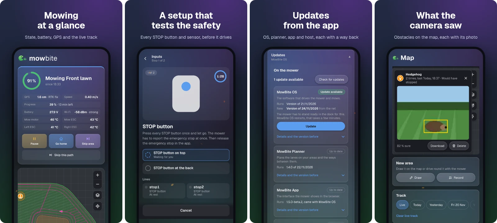
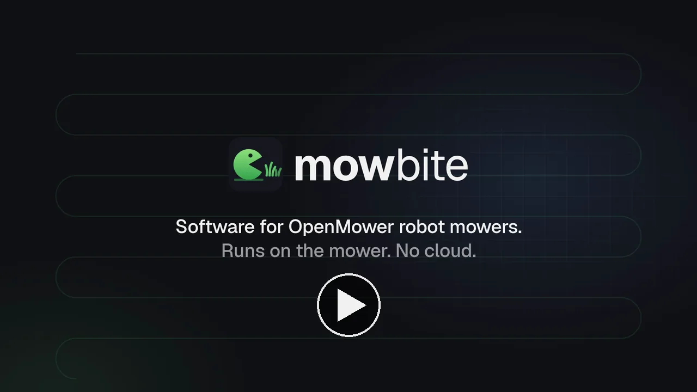
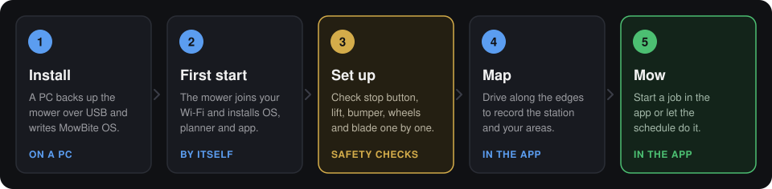
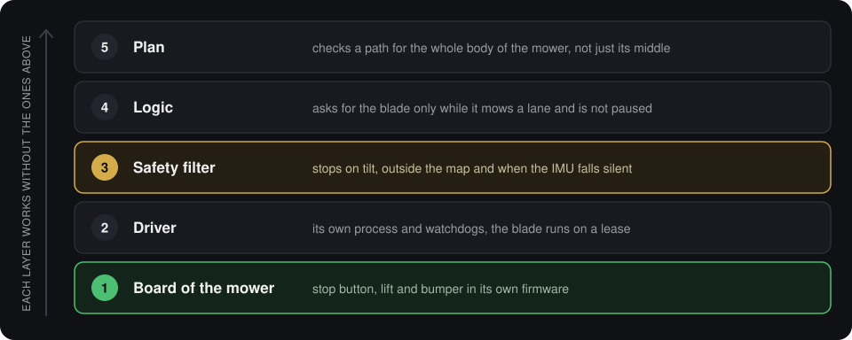
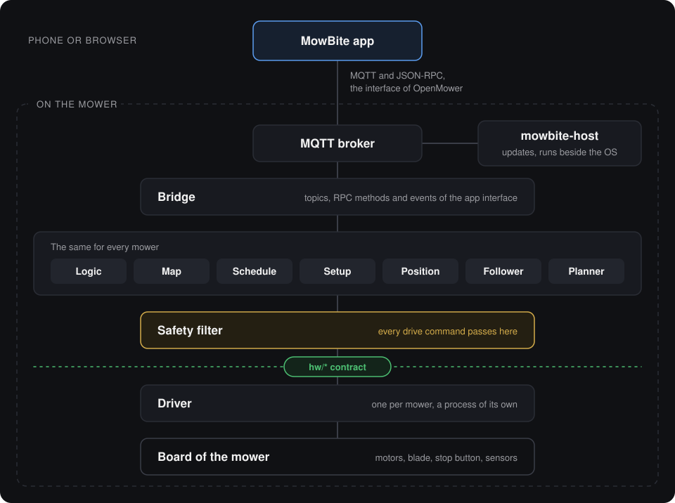
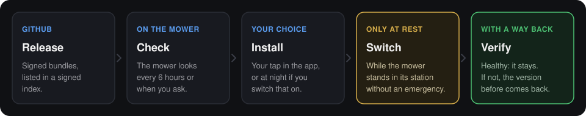

<p align="center">
  
</p>

<h1 align="center">MowBite OS</h1>

<p align="center">
  The software that runs a robot mower: positioning, mowing, docking and updates.<br>
  All of it on the mower itself. No cloud and no account.
</p>

<p align="center">
  
  
  <a href="LICENSE"></a>
  <a href="https://discord.gg/VpPFRx9Ce4"></a>
</p>

<p align="center">
  <a href="#get-started"><b>Get started</b></a> ·
  <a href="#safety"><b>Safety</b></a> ·
  <a href="#how-it-works"><b>How it works</b></a> ·
  <a href="docs/new-mower.md"><b>Add a mower</b></a> ·
  <a href="https://discord.gg/VpPFRx9Ce4"><b>Discord</b></a>
</p>



<p align="center">
  <a href="https://youtu.be/nUGaw1tlYOk"></a><br>
  <sub>MowBite in 83 seconds, on YouTube</sub>
</p>

MowBite OS runs on the mower's own computer in place of the vendor software. It finds its place on the lawn with RTK
GNSS, mows the areas you recorded, drives home, docks and charges. The mower works on its own in your home network.

You use it with the [MowBite app](https://github.com/mkaaaaaay/mowbite), in the browser on a phone or computer or as
an Android app. MowBite OS is built on [ROS 2 Jazzy](https://docs.ros.org/en/jazzy/). To the outside it speaks the
MQTT and JSON-RPC interface of OpenMower and adds methods of its own. The mower lists what it can do (`rpc.methods`),
so the app only shows what your mower really has.

> [!WARNING]
> **Beta.** MowBite OS runs on one mower so far, our own Airseekers Tron, and things still change. A robot mower has
> a turning blade and drives by itself. Read [Safety](#safety) before you put it on a mower.

MowBite OS is a community project and not affiliated with Airseekers or YardForce. Questions, test reports and news:
the [MowBite Discord](https://discord.gg/VpPFRx9Ce4).

## Contents

- [What it does](#what-it-does)
- [Get started](#get-started)
- [Supported mowers](#supported-mowers)
- [Safety](#safety)
- [How it works](#how-it-works)
- [Updates](#updates)
- [Add a mower](#add-a-mower)
- [Try it on a PC](#try-it-on-a-pc)
- [Build and test](#build-and-test)
- [The MowBite project](#the-mowbite-project)
- [License](#license)

## What it does

| | |
| --- | --- |
| **Map** | Drive the mower along the edges once and it records the areas and the docking station. The map is kept on the mower and can be changed in the app. |
| **Mowing** | The [MowBite Planner](https://github.com/mkaaaaaay/mowbite-planner) plans loops along the edge and straight lanes for the whole body of the mower. Pause, continue, skip a path or an area, mow several areas in one job. |
| **Going home** | When the job is done, the battery gets low, it rains or the sun sets, the mower drives to its station, docks and checks that it really charges. |
| **Schedule** | Plans with days, start, end and areas. It can skip rain, cold and a bad forecast and wait for the battery. Off until you allow it. |
| **Position** | RTK GNSS, gyro and wheel odometry in a filter of its own. The corrections come from an NTRIP caster you choose. A calibration drive measures wheel ticks, track width, antenna offset and how the IMU is mounted. |
| **Setup in the app** | Step by step, from choosing your mower to the first mow. Its safety steps are the safety measurement of your mower. |
| **Updates** | Signed bundles, installed from the app or at night. If the new version does not come up healthy, the one before comes back. |
| **Cameras** | The live picture of the mower's cameras in the app. |
| **Activity** | Event history, the track of every job, mowing statistics, maintenance reminders, sensor values of the last 48 hours, push messages through [ntfy](https://ntfy.sh). |
| **Diagnosis** | A journal of what the core parts got and decided. Around an emergency or a crash it keeps an incident you can download. A journal replays bit for bit on a PC. |
| **Lights and sounds** | Where the mower has them: a light profile per state, announcements, your own MP3s. |

## Get started



1. **Install.** The [MowBite OS installer](https://github.com/mkaaaaaay/mowbite-installer) puts MowBite OS on an
   Airseekers Tron from a Windows or Linux PC over a USB cable. It reads a full backup of the mower's flash first, and
   that backup is the way back to the vendor system. What you need and how it runs is in its README.
2. **First start.** The mower joins your Wi-Fi and installs the OS, the planner and the app from what the installer
   gave it. The installer finds it in your network and confirms the start.
3. **Set up.** Open the app and follow the setup. You check every stop button, the lift sensor, the bumper and the
   IMU by hand and enter your NTRIP caster. Then come the wheels with the mower on a stand, a short drive on the
   ground and the blade. Until these steps passed the mower only takes remote control and the blade stays locked.
4. **Map.** Enter the dimensions, record the docking station and the first area by driving along it, and let the
   mower do its calibration drive and a docking test.
5. **Mow.** Start a job in the app or set up the schedule.

The first drive of a mower: RTK fix, slow, someone at the stop button.

## Supported mowers

| Mower | Board | Status |
| --- | --- | --- |
| Airseekers Tron | its MCU on a serial port, GNSS and IMU read directly | **Beta**, on our own Tron: recording, mowing, driving home and docking run there. Needs vendor software 1.3.32 or 1.3.33 before the installation. |
| YardForce NX60i with an xCore board | xCore on Ethernet | **In progress.** Driver, platform package and simulation are there. The safety measurement on the mower is still open, so it is not ready for use. |

Every mower is reached through one neutral contract (`hw/*`). Nothing above the driver knows a mower by name, so a
new mower is a matter of a driver, a platform package and a measurement. See [Add a mower](#add-a-mower).

## Safety

A robot mower can hurt people and animals. MowBite OS comes without any warranty, and you are responsible for the
mower you run it on.



Several layers, each working without the ones above it:

1. **The board of the mower** with its own firmware: stop button, lift and bumper. What a board does by itself, for
   example how long it keeps driving without its host, is measured on each mower and never assumed.
2. **The driver**, a process of its own with its own watchdogs. Without a new drive command for 0.5 s it stops the
   wheels. The blade only runs on a lease that has to be renewed all the time, and never during an emergency. A driver
   that was restarted comes up locked.
3. **The safety filter**, the only writer of drive commands to the driver. It stops the mower when it tilts too far,
   when it leaves the areas of the map while driving by itself, and when the IMU falls silent.
4. **The logic** asks for the blade only while it mows a lane and is not paused. Every pause, by you, by a lost
   position or by an emergency, lets the blade stop.
5. **The plan**: the planner checks the whole body of the mower along a path, not just its middle.

On top of that:

- **Emergency.** Stop button, lift and bumper latch an emergency that stays until you release it.
- **Nothing by itself before the safety measurement.** A mower without it only takes remote control, and the blade
  is locked until its own step passed. The measurement belongs to one mower, not to a model: it is done on yours, with
  the setup steps in the app. A safety step that fails later closes the lock again.
- **Watchdogs for the software itself.** Every node has to report regularly, and one that hangs ends the stack. If
  the OS ends that way while the mower is working, nothing drives or mows after the restart until you release it.
  After three crashes in a row the stack stays down.
- **Careful defaults.** A new mower is limited to 0.3 m/s and 0.3 rad/s until driving tests show more. The schedule
  is off until you allow it.

What you should know:

- The MQTT broker on the mower has no login. Whoever is in your network can command the mower. Keep it in a network
  you trust and never open its ports to the internet.
- Bumper, lift and stop button are the emergency stop. Nothing in the software replaces them.

## How it works



- The **driver** is the only part that knows the board. It offers the same topics and services on every mower
  (`hw/status`, `hw/cmd_vel`, `hw/blade`, `hw/emergency`, ...).
- The **safety filter** sits between every source of drive commands and the driver.
- The **core** is the same for every mower: logic, map, schedule, setup, localization and path follower run together
  in one process, each in its own thread. The planner, the network service and the cameras are processes of their own.
- The **bridge** carries the MQTT topics and RPC methods of the app interface.
- A **platform package** (`platform_<name>`) holds what one mower needs: dimensions, values, its part of the start
  and the steps of the setup.
- **mowbite-host** runs beside the OS and installs updates, also while the OS is off.

Map and settings live in one data folder on the mower. Every log, recording and cache has a limit in days and MB.

The mower itself connects to: your NTRIP caster, a time server, [Open-Meteo](https://open-meteo.com) for the forecast
of the schedule, the ntfy server if you set up push messages, and GitHub for updates (`MOWBITE_UPDATE_NET=off` turns
that off).

The interface an app talks to is described in [src/mowbite_api/api.schema.json](src/mowbite_api/api.schema.json):
MQTT topics, every RPC method, events, reasons with their texts, settings and the setup. It is made from the code, and
`system.api` gives it at run time. It carries two numbers: `x-api` goes up with every change, `x-api-break` only when
something is taken away or changes its meaning.

## Updates



- Four parts are updated on their own: the OS, the planner, the app and mowbite-host. Each comes as a signed bundle,
  and the mower only installs what holds for the keys in its root file system.
- Bundles are published as releases of [mowbite-releases](https://github.com/mkaaaaaay/mowbite-releases) and listed
  in a signed `index.json`. The mower looks there every 6 hours and when you ask in the app. Without internet a bundle
  can be put into the inbox folder on the mower.
- Two channels: `stable` (the default) and `preview`. So far every release is a preview.
- Installing is your tap in the app, or automatic at night if you switch that on (off by default, 02:00 to 05:00).
- The OS and the planner switch only while the mower idles on its charging contacts without an emergency. After the
  switch the new OS has to come up healthy, else the one before comes back. You can also go back by hand.

This is how the Tron is updated. A mower on Docker Compose has no updater for the OS yet.

## Add a mower

[docs/new-mower.md](docs/new-mower.md) is the guide, with a check list at its end. In short, a new mower needs:

1. a **driver** for the `hw/*` contract, in a process of its own
2. a **fake board** for the simulation, so the driver contract test runs against it
3. a **platform package** with its dimensions, values, start and setup steps
4. a way **onto the mower**: Docker Compose or a root file system of its own
5. a **safety measurement** on the mower

Logic, follower, safety filter, map, planner, bridge and app stay as they are. Lights and cameras are optional. Start
from the closer one of the two drivers there are.

## Try it on a PC

The whole OS runs against a simulated Tron (board, GNSS and IMU on byte level), with a broker and the app. You need
Docker with buildx and a clone of the planner beside this repo:

```bash
git clone https://github.com/mkaaaaaay/mowbite-planner.git ../mowbite-planner
docker buildx build --load --build-context planer=../mowbite-planner -f docker/dev.Dockerfile -t mowbite-os-dev:jazzy .
docker compose -f docker/sim/compose.yaml up -d --build
```

Then open `http://localhost:48082`. MQTT is on port 41883, its WebSocket on 49001. Sensors of the simulated board are
set through a file, for example the lift:

```bash
docker exec omtron-mowbite_os-1 sh -c 'echo "{\"lift\": 1}" > /tmp/mowbite_sim_flags.json'
```

Stop it with `docker compose -f docker/sim/compose.yaml down`.

## Build and test

Everything builds and runs in the image `mowbite-os-dev:jazzy` from above. Unit tests of all packages, with compiler
warnings as errors:

```bash
docker run --rm -v "$PWD/src:/ws/src:ro" mowbite-os-dev:jazzy bash -c '
  . /opt/ros/jazzy/setup.sh && . /opt/mowbite_planner/setup.sh && cd /ws &&
  colcon build --packages-skip mowbite_sim --cmake-args -DCMAKE_BUILD_TYPE=Release -DCMAKE_COMPILE_WARNING_AS_ERROR=ON &&
  colcon test --packages-skip mowbite_sim --return-code-on-test-failure; colcon test-result --verbose'
```

Tests of the whole stack are launch tests in `src/mowbite_sim/test`, one file per topic (mowing, docking, going home,
the driver contract of each mower, the setup, ...). Each brings its own broker. In the simulation image:

```bash
docker run --rm local/mowbite-os-sim:dev launch_test /ws/src/mowbite_sim/test/test_mowing.py
```

The updater and the web server are plain Python. Their tests need `mosquitto`, `python3-paho-mqtt` and `ssh-keygen`:

```bash
for t in host/test/test_*.py web/test/test_web.py platform/tron/bundle/test_update.py; do python3 -I "$t"; done
```

`src/mowbite_sim/test/app_interface_check.py` checks a running OS against the app interface. The workflow
[check.yaml](.github/workflows/check.yaml) runs the unit tests on arm64 and amd64, the app interface check against the
simulation and the replay of its journal.

How the code is written: protocol and control code without ROS in libraries with unit tests, thin ROS nodes around
them, C++ formatted with `.clang-format`, no findings of `.clang-tidy`.

<details>
<summary><b>What is where</b></summary>

| Folder | What |
| --- | --- |
| `src/` | the ROS 2 packages, see below |
| `platform/tron/` | what the Tron needs besides its packages: its root file system (`rootfs/`) and the scripts that make, sign and publish bundles (`bundle/`) |
| `host/` | mowbite-host, the updater beside the OS, with its tests |
| `web/` | mowbite-web, a small web server for the app on the mower |
| `docker/` | Dockerfiles for building and testing, the simulation and the mower image, and the compose files |
| `tools/yf/` | the program of the safety measurement at the mower (`measure.py`) and its tests |
| `docs/` | [new-mower.md](docs/new-mower.md), how to add a mower, and the pictures of this page |

The packages in `src/`:

| Package | What |
| --- | --- |
| **Driving and mowing** | |
| `mowbite_logic` | states, actions and sensors: mowing, docking, undocking, recording |
| `mowbite_follower` | path follower |
| `mowbite_safety` | safety filter between every source of drive commands and the driver |
| `mowbite_localization` | position from gyro, wheel speed and RTK GNSS |
| `mowbite_map` | areas and docking stations, stored on the mower |
| `mowbite_calibration` | calibration drive |
| `mowbite_obstacles` | obstacles the sensors of a mower report |
| `mowbite_schedule`, `mowbite_time` | the schedule, the sun and whether the clock can be trusted |
| `mowbite_setup` | the setup |
| `mowbite_stats` | statistics, maintenance, incidents |
| **To the outside** | |
| `mowbite_bridge` | the MQTT topics and JSON-RPC of the app, event history, mowing track |
| `mowbite_api` | the catalog of the app interface and its JSON Schema |
| `mowbite_ntrip` | NTRIP client for the RTK corrections |
| `mowbite_net` | weather for the schedule, push messages |
| `mowbite_camera` | the cameras for the app, MJPEG and WebRTC |
| `mowbite_light`, `mowbite_sound` | lights and sounds |
| **Mowers** | |
| `platform_tron`, `tron_mcu`, `tron_gnss`, `tron_imu`, `tron_vision`, `tron_buttons` | Airseekers Tron: platform package, driver of its MCU, GNSS, IMU, cameras, buttons |
| `platform_nx60i`, `xcore_driver` | YardForce NX60i: platform package, driver for its xCore board |
| **Shared parts** | |
| `mowbite_bringup` | the start of the stack and the parameters every mower shares (`stack.yaml`) |
| `mowbite_msgs` | messages and services |
| `mowbite_sim` | simulated boards and the tests of the whole stack |
| `mowbite_journal`, `mowbite_replay` | the journal and its replay |
| `mowbite_watch`, `mowbite_hold`, `mowbite_component` | watchdog of a process, holds and locks, how nodes are built and started |
| `mowbite_serial`, `mowbite_gnss`, `mowbite_outbox` | serial port, GNSS helpers and queues for drivers |

</details>

## The MowBite project

- [MowBite](https://github.com/mkaaaaaay/mowbite): the app on the mower, with live dashboard, map editor, recording
  areas by driving, schedule and history. Also on
  [Google Play](https://play.google.com/store/apps/details?id=io.github.mkaaaaaay.mowbite).
- [MowBite OS installer](https://github.com/mkaaaaaay/mowbite-installer): puts MowBite OS on an Airseekers Tron over
  USB and takes it back to the vendor system.
- [MowBite Planner](https://github.com/mkaaaaaay/mowbite-planner): the mowing planner, it keeps the whole mower away
  from edges and obstacles, not just its middle.
- [mowbite-releases](https://github.com/mkaaaaaay/mowbite-releases): the signed release files of MowBite OS.
- [MowBite for Home Assistant](https://github.com/mkaaaaaay/mowbite-ha): Home Assistant integration for OpenMower
  mowers, with the MowBite card and map.
- [MowBite Updater](https://github.com/mkaaaaaay/mowbite-updater): keeps OpenMower, MowBite and the planner up to
  date on OpenMower mowers.
- [MowBite Discord](https://discord.gg/VpPFRx9Ce4): questions, test reports and news.

## License

Copyright 2026 mkay

[PolyForm Strict 1.0.0](https://polyformproject.org/licenses/strict/1.0.0), see [LICENSE](LICENSE). You may use
MowBite OS for any noncommercial purpose. You may not pass it on or change it, with one exception: you may change it
to propose that change as a pull request to this repository. With a contribution you give the licensor the right to
use it under any terms, commercial ones too. The exact words are at the top of [LICENSE](LICENSE). Commercial use
needs a separate license from the licensor, for contact see the profile of
[mkaaaaaay](https://github.com/mkaaaaaay). MowBite OS comes without any warranty.

- `src/mowbite_sound/third_party/minimp3` is [minimp3](https://github.com/lieff/minimp3) under CC0 1.0.
- Images and bundles also bring programs of their own under their own licenses: the MowBite Planner and the MowBite
  app (PolyForm Noncommercial 1.0.0), MediaMTX (MIT) for the camera streams and, on arm64, Rockchip MPP (Apache-2.0 or
  MIT).
- Models and runtimes of a mower's vendor are never part of this repository, of a published image or of a bundle.
  They stay on the mower.
